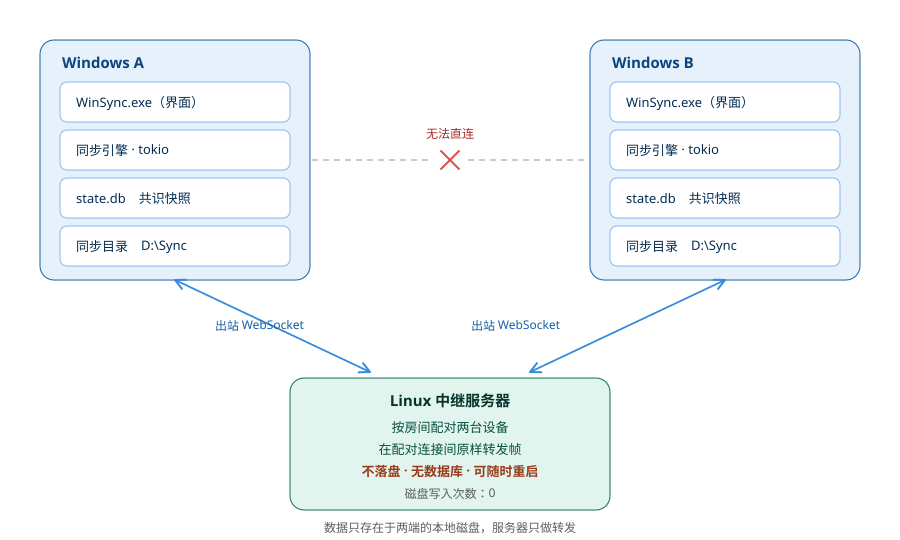

# WinSync

两台 Windows 之间双向同步文件夹，中间经一台 Linux 服务器中继。Rust 实现，客户端是单个 `WinSync.exe`，无运行时依赖。

**为什么要中继**：两台 Windows 无法直接互联（不同子网、无公网入口、不能做 NAT 穿透），但都能主动连到同一台 Linux。所以让 Linux 做转发，而不是做存储。



## 核心取舍

服务器是**无状态中继**：不建库、不挂卷、不落盘，只做三件事——校验 token、按房间把两台连接配对、在两端之间原样转发帧。重启没有副作用。

代价是一条硬约束：

> **两台 Windows 必须同时在线，才能完成一次同步。**

服务器不缓存内容，就无法替离线的一方保存变更。这是物理约束，不是实现问题。数据始终留在两端本地磁盘上，不会丢，只是"另一台看到新内容"的时间被推迟。

换来的是复杂度下降一个量级：没有 NAT 穿透、没有对等发现、没有版本向量、没有时钟同步问题。变更判定退回两端自己做——**三方比较 `base`（上次共识）/ `local` / `remote`**，因为只有两台设备，一个共识快照就够。

## 工程结构

```
.
├── docs/
│   ├── windows-sync-design.md   设计文档（协议、数据模型、算法、踩坑）
│   └── architecture.svg         架构图
└── sync/
    ├── crates/
    │   ├── sync-proto/          帧编解码 + 消息定义
    │   ├── sync-core/           扫描 · BLAKE3 · 三方比较 · 状态库 · 原子落地
    │   ├── sync-server/         无状态中继
    │   └── sync-client/
    │       ├── src/session.rs             同步会话状态机
    │       ├── src/bin/winsync-gui.rs     图形界面 ← 主入口
    │       └── src/main.rs                命令行（排查用）
    └── deploy/                  Dockerfile · systemd · 安装与编译脚本
```

## 构建

需要 Rust stable（MSVC 工具链）与 Windows SDK。Windows 客户端与服务端可分开构建。

```bash
cd sync

# Windows 客户端（产出 target/release/winsync-gui.exe）
cargo build --release -p sync-client

# 单元测试
cargo test --workspace

# Linux 服务端（在 Linux/WSL 上执行，产出静态二进制）
cargo build --release -p sync-server --target x86_64-unknown-linux-musl
```

国内网络建议先把 cargo 源指向镜像，否则拉依赖会很慢：

```toml
# ~/.cargo/config.toml
[source.crates-io]
replace-with = 'rsproxy-sparse'

[source.rsproxy-sparse]
registry = 'sparse+https://rsproxy.cn/index/'

[net]
git-fetch-with-cli = true
```

## 部署服务端

服务器只需要**一个约 8 MB 的静态二进制**，不需要数据库、Redis、对象存储，也不需要在服务器上装 Rust（除非选择就地编译）。

```bash
# 上传二进制与脚本后，一条命令完成：建系统用户、生成密钥、注册 systemd、启动
sudo ./deploy/install.sh ./sync-server
```

脚本最后会打印密钥和客户端该填的地址。升级只替换二进制后 `systemctl restart winsync`，密钥不丢。

Docker 方式、放行端口、TLS 终止、常用运维命令见 [`sync/deploy/README.md`](sync/deploy/README.md)。

## 使用客户端

1. 双击 `WinSync.exe`
2. 点「+ 新建任务」，三步：选本地目录 → 填服务器/密钥/房间 → 选模式与过滤
3. 任务卡上点「立即同步」，或交给自动同步

界面分四页：**任务**（任务列表与状态）、**记录**（文件级操作，可导出 CSV）、**日志**（原始日志）、**设置**（选中任务的连接、模式、过滤）。

### 任务

一个任务 = 一条「本机目录 ⇄ 服务器房间」的绑定。可以建多个，各自独立的同步方向、过滤规则、状态与记录。

- **暂停**：停止该任务的自动同步（手动「立即同步」仍可用），其他任务不受影响
- **删除**：只删任务配置，状态库保留在 `%APPDATA%\WinSync\tasks\<id>.db`，便于恢复基线
- 每个任务一个状态库，基线、哈希缓存、设备身份互不干扰

旧版本的单任务配置会在首次启动时**自动迁移**成一个任务，并把原来的 `state.db` 复制过来（基线不丢）。

之后自动同步常驻：目录变更 3 秒内触发，另有 30 秒轮询兜底。两台都在线时一次会话通常几百毫秒完成。

配置在 `%APPDATA%\WinSync\config.json`，任务状态在 `tasks/<id>.db`，运行日志在 `sync.log`。

### 同步模式

| 模式 | 行为 | 适用 |
|---|---|---|
| 双向（默认） | 既推也拉，冲突各留一份 | 常规用法，两端都设这个 |
| 仅上传 | 只把本机变更推给对方 | 单向备份，接收端设「仅下载」 |
| 仅下载 | 只接收对方变更 | 只读镜像，接收端不上传 |

单向是**两端配合**的设置：发送端「仅上传」+ 接收端「仅下载」。两端都设「仅上传」时谁都不拉取，等于不传输。

### 过滤规则

按点文件（`.git`、`.env`）、扩展名（`lnk,pst,tmp`）、大小区间过滤。**两端必须完全一致**——不一致时程序会中止同步并打印双方的规则签名，因为一方忽略的文件在另一方看来就是"被删除"，会把删除传播回去。

改动规则会清空共识快照并重建（只重建索引，不删除任何文件）。

## 同步行为

| 场景 | 结果 |
|---|---|
| 只有一边有 | 传过去 |
| 两边都有、内容相同 | 跳过（比较 BLAKE3，不看 mtime） |
| 两边都有、内容不同 | 各留一份，产生 `.conflict-<设备>-<时间戳>` 副本 |
| 一边改了、一边删了 | 修改优先，不删数据 |
| 一边删了、一边没动 | 删除传播到另一端 |

四道安全阀，都是踩过坑之后加的：

- **删除熔断**：单次会话要删超过 20 个文件、或超过基线的 30%，直接中止并列出路径
- **目录一致性检查**：两端 `root` 指向不同目录时拒绝同步，避免把"对面没有"误判成"你删了"
- **过滤规则一致性检查**：规则不同直接中止，避免传播删除
- **同步前自动落盘配置**：界面上填的就是实际生效的，不会出现"改了没保存、重启跑回旧路径"

基线只记录「双方确认一致」的路径，不记录本地扫描结果。这样切换同步模式后不会把"从没上传过的文件"误判成"被对方删除"。

## 实现状态

已实现并实测通过：双向增量同步、单向模式（仅上传 / 仅下载）、过滤规则与一致性校验、冲突副本、删除与目录传播、原子落地（临时文件 + rename）、路径穿越防护、无状态中继、三页图形界面（同步 / 记录 / 日志）、文件级记录、目录实时监听、删除熔断、配置校验、日志落盘、单实例、exe 版本资源、等待对端心跳。

尚未实现：

| 项目 | 影响 |
|---|---|
| **按需下载（Windows Cloud Files 占位符）** | 资源管理器里看不到"未下载"的远端文件，双击也不会自动拉取。这是与成熟网盘客户端差距最大的一项 |
| 选择性同步（只选子目录） | 只能整目录同步，或用过滤规则绕开 |
| 断点续传 | 大文件中途断开会从头重传 |
| 重命名优化 | 改名等同删除 + 新增，会重传整个文件 |
| 托盘常驻 / 开机自启 / Windows 服务 | 关掉窗口就停止同步 |
| 带宽限速 | 同步会占满上行 |
| 安装包 / 自动更新 | 目前是绿色单文件 |
| TLS | 目前是 `ws://` 明文，公网使用需前置 Caddy 或 nginx |

## 常见问题

**「立即同步」按钮是灰的** — 配置不完整。界面状态区会用红字列出缺哪一项。

**两端都显示"等待对端上线超时"** — 两台没同时在线。各自窗口 25 秒、周期 28–34 秒抖动，正常一两分钟内会碰上。

**报「两端的过滤规则不一致，已中止」** — 两台的忽略规则不同。这是有意拦住的：规则不一致会把"被忽略的文件"当成"被删除"。把两边的过滤设置配成完全一样即可。

**设了单向模式但文件没过去** — 单向需要两端配合：发送端「仅上传」、接收端「仅下载」。两端都设「仅上传」时没有任何一方会拉取。

**同步方向不对、或者开始删文件** — 立刻关掉两端程序，检查 `config.json` 里的 `root` 是否指向同一个目录。删错了不要紧，另一端通常还留着副本。

**两台设备 device_id 相同** — 说明把 `%APPDATA%\WinSync\state.db` 从一台拷到了另一台。删掉它重启，程序会生成新身份。**只拷 `config.json`，不要拷 `state.db`。**

**配置文件看起来是对的但程序读不到** — 检查是不是带 UTF-8 BOM（`EF BB BF`）。当前版本已兼容，旧版本会因此静默失败。

## 文档

- [设计文档](docs/windows-sync-design.md) — 协议、数据模型、三方比较算法、Windows 专项坑
- [服务端部署](sync/deploy/README.md) — 编译方式、安装、升级、防火墙、TLS
