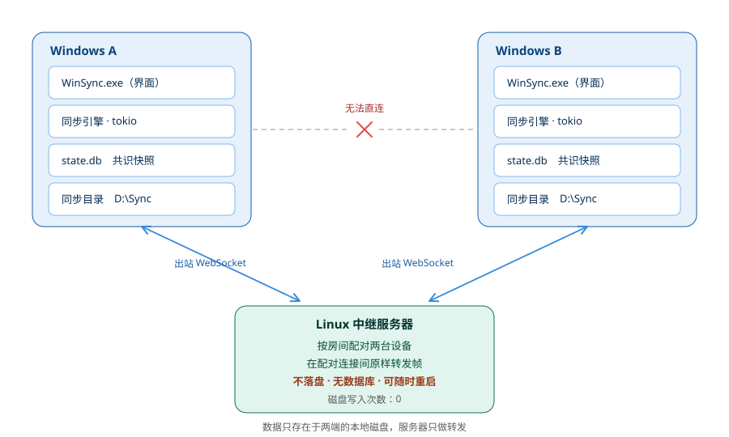

# Windows 文件夹双向同步 — 设计文档

两台 Windows 通过一台 Linux 服务器中转，保持指定文件夹双向一致。服务器不存储任何数据。

---

## 1. 需求与约束

| 项目 | 内容 |
|---|---|
| 同步对象 | 两台 Windows 上的**单个**指定文件夹，双向同步 |
| 网络 | 两台 Windows **无法直连**，但都能**出站**访问一台 Linux 服务器 |
| 服务器角色 | **纯转发**，磁盘不存储任何业务数据 |
| 文件规模 | 单文件 ≤ 4 GB；不需要历史版本 |
| 设备数 | 两台 |
| 交付形态 | 图形界面程序 `WinSync.exe`，双击即用，无运行时依赖 |

---

## 2. 架构



三个角色，职责很窄：

| 角色 | 职责 | 不负责 |
|---|---|---|
| Windows A / B | 扫描本地、算差异、收发文件、维护共识快照 | 不需要知道对方存在 |
| Linux 中继 | 校验密钥、按房间配对、在两连接间原样转发帧 | 不解析文件内容、不存盘、不排序变更 |

**关键点：服务器完全无状态。** 不建库、不挂卷、不需要备份、可随时重启、可水平扩容。进程重启只会让所有连接断开，客户端自动重连重建，没有任何状态需要恢复。

---

## 3. 为什么用 Rust

选型依据是这个项目的四个特征：**常驻运行 + 大文件流式处理 + 海量小文件哈希 + 单文件交付**。

| 维度 | Rust | 对比方案 | 对本项目的意义 |
|---|---|---|---|
| 交付形态 | 单个 `.exe`，静态链接，无运行时依赖 | C# 需 .NET 运行时；Electron 要打包 100 MB+ Chromium | 拷过去双击就能跑，不用先装环境 |
| 内存占用 | 常驻通常 10–30 MB | Electron 空载即 100 MB+ | 要长期挂在托盘，差 10 倍是实打实的 |
| GC 停顿 | 无垃圾回收，无 STW 暂停 | C#/Go/Java 堆增长时有可感知停顿 | 扫 10 万文件、传 4 GB 文件时界面不卡 |
| 哈希性能 | `blake3` 自带 SIMD + 多线程 | 需自行接 OpenSSL 或写并行代码 | 哈希是同步的性能热点 |
| 并发正确性 | 所有权模型编译期消除数据竞争 | C/C++ 靠 review 和运气 | "网络协程 + 文件操作 + UI"三线程共享状态，最容易埋隐性 bug |
| 跨平台复用 | 核心逻辑与平台无关 | WPF/WinForms 绑死 Windows | 服务器是 Linux，将来加 Linux/macOS 客户端只换 UI 层 |

**成本也要说清楚**：

1. **GUI 生态偏弱**。没有 WPF 那种成熟控件库，界面朴素。这是本方案最大的妥协——用"单文件、无依赖"换了界面精致度。
2. **开发速度慢于 Go/Python**。借用检查器会在编译期挡下很多写法。
3. **编译时间长**。全量几分钟，改动后增量尚可。
4. **交接成本高**。接手的人要懂 async Rust。

**结论**：内部少数人使用、看重稳定与低占用，Rust 划算；要求界面精致、快速迭代、多人协作，C# + WPF 更省事。

---

## 4. 核心设计

### 4.1 一致性模型：双端三方比较

服务器不做排序，一致性判定由两端各自完成。因为只有两台设备，不需要版本向量，只需要一份共识快照。

每台设备维护三份信息：

| 名称 | 含义 |
|---|---|
| `local` | 磁盘上的实际文件 |
| `base` | 上次同步成功时双方的共识状态（`path → blake3`） |
| `remote` | 本次会话拿到对方的索引 |

判定规则（逐 path）：

| local vs base | remote vs base | 结论 |
|---|---|---|
| 未变 | 未变 | 跳过 |
| 未变 | 已变 | 从对方拉取 |
| 已变 | 未变 | 推给对方 |
| 已变 | 已变，内容相同 | 跳过 |
| 已变 | 已变，内容不同 | **冲突**，保留双方 |
| 一方删除 | 另一方未变 | 传播删除 |
| 一方删除 | 另一方已修改 | **保留修改**，删除不生效 |

会话结束后双方重扫本地并重写 `base`。

### 4.2 必须同时在线

> 两台 Windows 必须同时在线，才能完成一次同步。

服务器不缓存内容，就无法替离线的一方保管变更。这是物理约束，不是实现缺陷。

可接受的理由：两端都是办公设备，白天同时在线窗口很长；**数据始终在两端本地磁盘上，不会丢**，只是"另一台看到新内容"的时间被推迟。

工程上的补偿手段：
- 程序常驻、开机自启、保持长连接
- 配对成功即触发同步，不轮询
- 提供"立即同步"手动按钮
- 自动同步每 30 秒尝试一次，等待对端最多 8 秒，不会挂住界面

### 4.3 目录变更

`base` 的主键是**相对同步根目录的路径**。根目录一旦改变，这些路径指向的就是另一批文件，继续沿用会误判：把已存在的文件当新增（重复上传），把仍存在的文件判为删除（误删对端）。

所以检测到目录变化时**必须清空 `base` 和 `pending`**，下一次会话按"全量重建共识"处理。GUI 会弹窗确认，CLI 需要 `--force`。

---

## 5. 协议

### 5.1 帧格式

WebSocket 二进制帧，一条消息一帧：

```
[0]      tag: 0 = 控制帧(JSON), 1 = 数据帧
控制帧 : tag + UTF-8 JSON
数据帧 : tag + u32be(header_len) + header JSON + payload
```

文件内容走数据帧，服务器不解析 payload，直接转发。

### 5.2 消息

| 消息 | 方向 | 用途 |
|---|---|---|
| `Hello` | C→S | 报到，带 device_id / workspace / 协议版本 |
| `PeerStatus` | S→C | 告知对端是否在线 |
| `Bye` | S→C | 断开原因 |
| `IndexDigest` | C↔C | 文件树摘要，相同则零传输 |
| `IndexChunk` | C↔C | 分页传输完整索引 |
| `FileOffer` | C↔C | 声明要发某文件 |
| `FileRequest` | C↔C | 接受，请发块 |
| `FileChunk` | C↔C | 文件分块（数据帧） |
| `FileDone` / `FileAck` | C↔C | 发送完成 / 落地结果 |
| `Mkdir` / `Delete` | C↔C | 目录创建 / 删除传播 |
| `PushDone` | C↔C | 本轮推送结束，轮到对端 |
| `SessionEnd` | C↔C | 会话收尾（预留） |

`Conflict` 与 `Rename` 已在协议中定义，当前版本未使用——冲突通过本地生成副本处理，重命名按"删除 + 新增"传播。保留它们是为了后续做重命名优化（同 blake3 直接改名，不重传）。

### 5.3 会话时序

```
A                           服务器                           B
│  Hello ──────────────────►│                              │
│◄──────────── PeerStatus(false/true)                        │
│                            │◄───────────────── Hello ─────│
│◄──────────── PeerStatus(true, B)         PeerStatus(true, A) ──►│
│                            │                              │
│  IndexDigest ─────────────►│─────────────────────────────►│
│◄───────────────────────────│────────────── IndexDigest ───│
│        摘要相同 → 直接结束（零传输）                        │
│        摘要不同 → 互发 IndexChunk                          │
│                            │                              │
│        各自计算三方差异                                     │
│  （device_id 字典序小的一方先推）                            │
│  FileOffer/Chunk/Ack ─────►│─────────────────────────────►│
│  PushDone ────────────────►│─────────────────────────────►│
│◄───────────────────────────│◄───────── FileOffer/Chunk ───│
│◄───────────────────────────│◄────────────── PushDone ─────│
│  Delete 双向传播            │                              │
│  重扫本地 → 写 base         │              重扫本地 → 写 base│
```

### 5.4 为什么单向串行，而不是双向并发

两端同时推送会让 `Offer / Request / Chunk / Ack` 四条消息流交错，状态机极难写对，死锁和消息错配几乎无法避免。

因为只有两台设备，约定 `device_id` 字典序小的一方先推、另一方先收，完成后再交换角色。代价是总耗时略长（无法并行），换来的是**可验证的顺序语义**。这个交易值得。

---

## 6. 数据模型

### 6.1 客户端（SQLite，`%APPDATA%\WinSync\state.db`）

```sql
CREATE TABLE base (              -- 共识快照，唯一需要跨会话保留的状态
    path    TEXT PRIMARY KEY,
    kind    INTEGER NOT NULL,    -- 0=file 1=dir
    size    INTEGER NOT NULL,
    blake3  TEXT NOT NULL,       -- 目录为空串
    mtime   INTEGER NOT NULL
);

CREATE TABLE pending (           -- 对端离线期间积压的变更
    path    TEXT PRIMARY KEY,
    op      TEXT NOT NULL,       -- create|modify|delete
    blake3  TEXT,
    size    INTEGER,
    mtime   INTEGER,
    retry   INTEGER NOT NULL DEFAULT 0
);

CREATE TABLE meta (k TEXT PRIMARY KEY, v TEXT NOT NULL);
-- 键：device_id / root / last_session_id
```

文件内容不在这里另存一份，永远只存在于用户自己的目录中。

### 6.2 配置（`%APPDATA%\WinSync\config.json`）

```json
{
  "server": "ws://1.2.3.4:8443/ws",
  "token": "共享密钥",
  "workspace": "default",
  "root": "D:\\Sync"
}
```

GUI 与 CLI 共用。`WINSYNC_CONFIG` / `WINSYNC_DB` 可覆盖路径，用于本机跑两个实例做测试。

---

## 7. 关键算法

### 7.1 变更检测

- 快速筛选：`size` 或 `mtime` 与 `base` 不同 → 候选。
- 确认：对候选文件算 BLAKE3，与 `base.blake3` 比对。
- **只用 mtime 做筛选，绝不用它判断新旧**。两台机器的时区、时钟漂移、FAT 2 秒精度都会骗人。

### 7.2 冲突

只在"双方都改了同一文件"时发生。

- 规则：**保留双方**。本地版本改名为 `原名.conflict-<设备短ID>-<UTC时间戳>.<扩展名>`，对方版本落地为原名。
- 不做"最后写入者胜出"——`mtime` 不可比。
- 冲突副本会写回 `base`，下次会话当普通文件同步，双方都能看到两份。

### 7.3 删除

- 删除写入 `Delete` 消息，对端收到后删本地文件。
- 与修改冲突时**修改胜出**：一方删除、另一方修改，则保留修改。
- 删除操作幂等，重复执行无副作用。

### 7.4 分块与原子落地

- 固定 4 MB 分块，每块带 BLAKE3。
- 接收端写入同目录的 `.<文件名>.synctmp`，逐块校验，全部收完后**校验整体哈希再 `rename` 覆盖**。
- 中途失败或断电，目标文件仍是旧的完整版本，不会出现半个文件。
- 临时文件必须与目标同目录——跨分区 `rename` 会退化成拷贝，失去原子性。

### 7.5 路径安全

对端发来的相对路径可能是 `..\..\Windows\System32`。任何绝对路径、盘符、`..` 分量一律拒绝，拼接后再用 `canonicalize` 校验结果仍在根目录内。否则等于给对端一个写任意文件的权限。

---

## 8. Windows 专项

| 问题 | 处理 |
|---|---|
| 长路径 | 内部统一相对路径 + `/` 分隔，落地时按需加 `\\?\` 前缀 |
| 大小写不敏感 | 索引键统一小写，原名单独保留用于落地 |
| 非法文件名 | 落地前校验保留名（`CON`/`PRN`/`AUX`…）与非法字符，跳过并告警 |
| 文件被占用 | `ERROR_SHARING_VIOLATION` 进重试队列，指数退避，**不能直接跳过**（跳过等于丢变更） |
| 传输中文件变大 | 发块前记录大小，收完核对；不一致则整文件重传 |
| 控制台乱码 | 默认代码页 936，客户端启动时调 `SetConsoleOutputCP(65001)` |
| 界面中文字体 | egui 内置字体不含中文，启动时加载系统 `simhei.ttf` / `deng.ttf` |
| 权限 | 不同步 NTFS ACL，只同步内容 |

---

## 9. 工程结构

```
sync/
├── Cargo.toml
└── crates/
    ├── sync-proto/              消息与帧编解码
    │   └── src/lib.rs
    ├── sync-core/               扫描 · 哈希 · 三方比较 · 状态库 · 文件落地
    │   ├── src/index.rs
    │   ├── src/db.rs
    │   └── src/fileio.rs
    ├── sync-server/             无状态中继
    │   └── src/main.rs
    └── sync-client/
        ├── src/lib.rs
        ├── src/config.rs        配置读写
        ├── src/session.rs       会话状态机
        ├── src/main.rs          CLI（排查用）
        └── src/bin/winsync-gui.rs   图形界面 ← 主入口
```

依赖：

```toml
tokio           异步运行时
tokio-tungstenite / axum + ws   WebSocket 客户端 / 服务端
blake3          内容哈希
rusqlite        本地状态库（bundled，自带 SQLite）
walkdir         目录遍历
eframe (glow)   图形界面
rfd             文件夹选择对话框
```

---

## 10. 实现状态

**已完成并实测通过**

| 模块 | 状态 |
|---|---|
| 帧编解码（控制帧 + 数据帧） | ✅ 2 个单元测试 |
| 目录扫描 · BLAKE3 · 共识摘要 | ✅ |
| 三方差异计算 | ✅ 5 个单元测试 |
| 路径穿越防护 | ✅ 单元测试 |
| 本地状态库（base / pending / meta） | ✅ |
| 无状态中继（配对 · 转发 · 上下线通知） | ✅ |
| 索引交换 + 摘要预筛 | ✅ |
| 文件分块传输 · 原子落地 · 哈希校验 | ✅ |
| 冲突副本 | ✅ |
| 删除与目录传播 | ✅ |
| 图形界面（配置 · 同步 · 日志 · 自动同步） | ✅ |
| 目录变更检测与基线重建 | ✅ |
| 目录实时监听（notify，3 秒去抖 + 轮询兜底） | ✅ |
| 删除熔断（单次 >20 个或 >基线 30% 即中止） | ✅ |
| 配置校验 · BOM 兼容 · 日志落盘 | ✅ |
| 单实例 · exe 版本资源 | ✅ |
| 同步模式（双向 / 仅上传 / 仅下载） | ✅ 三模式实测 |
| 过滤规则（点文件 · 扩展名 · 大小区间） | ✅ 3 个单元测试 + 端到端 |
| 过滤规则签名校验（不一致拒绝同步） | ✅ 实测双向拒绝 |
| 文件级记录（界面「记录」页） | ✅ |
| 等待对端时的心跳（防僵尸误杀） | ✅ 25 秒阈值下稳定等待 70 秒 |
| 基线 = 双方确认一致的路径（而非本地扫描结果） | ✅ 见 13.4 |

实测记录（v0.3.0）：

```
双向 + 过滤     A 索引 3 条（.env/.git/.lnk 被过滤）→ B 收到 2 个文件，0 删除
仅上传/仅下载   A 只推不入（忽略 1 项对端变更），B 只入不推；切换回双向后 0 删除
过滤不一致      两端各自中止并打印双方签名，无任何文件变动
心跳            服务端空闲阈值 25 秒，单端等待 70 秒不中断，按预期超时退出
```

**尚未实现**

| 项目 | 影响 |
|---|---|
| Windows 服务 / 托盘常驻 | 关掉窗口就停止同步，需要开机自启支持 |
| 断点续传 | 大文件中途断开会从头再来 |
| 重命名优化 | 改名等同于删除 + 新增，大文件会重传 |
| 带宽限速 | 同步会占满上行 |
| 安装包 / 自动更新 | 目前是绿色单文件 |
| TLS（内建） | 目前明文 `ws://`，公网需前置 nginx / Caddy |
| `pending` 队列 | 表已建但未使用，离线变更靠重扫全量比对覆盖 |

---

## 11. 部署与使用

**服务端（Linux）**

服务器上只需要**一个约 8 MB 的静态二进制**，不需要数据库、Docker、也不需要 Rust 工具链（除非选择在服务器上编译）。完整的编译、安装、升级、放行端口步骤见 [`sync/deploy/README.md`](../sync/deploy/README.md)。

```bash
# 编出 musl 静态二进制：服务端是纯 Rust 实现，没有 C 依赖，可以完全静态链接
rustup target add x86_64-unknown-linux-musl
cargo build --release -p sync-server --target x86_64-unknown-linux-musl

# 上传后一键安装：建系统用户、生成随机密钥、注册 systemd、启动
sudo ./deploy/install.sh ./sync-server
```

服务端不落盘、无状态，重启只会让连接断开，客户端自动重连，没有任何数据需要恢复。

建议用 systemd 托管：

```ini
[Unit]
Description=WinSync relay
After=network.target

[Service]
Environment=SYNC_TOKEN=换成你的密钥
Environment=SYNC_ADDR=0.0.0.0:8443
ExecStart=/opt/winsync/sync-server
Restart=always

[Install]
WantedBy=multi-user.target
```

TLS 由 nginx / Caddy 在前端终止，或后续接入 `rustls`。服务器本身不落盘，无状态，重启无副作用。

**客户端（两台 Windows）**

1. 双击 `WinSync.exe`
2. 填服务器地址、密钥、房间名（两台必须一致）
3. 选择要同步的文件夹
4. 保存配置，点"立即同步"

两端都开着时会在 30 秒内自动完成同步。

---

## 12. 风险与已知限制

| 风险 | 影响 | 应对 |
|---|---|---|
| 两端长期不同时在线 | 同步停滞 | 程序常驻 + 手动触发；这是无状态中继的固有限制 |
| 中转服务器宕机 | 同步暂停 | 两端本地数据不受影响；重启即恢复，重新握手 |
| 首次同步已有大量历史文件 | 产生大量冲突副本 | 先让一台完整推送并同步一次，另一台再开始 |
| 大文件弱网 | 反复从头重传 | 待实现断点续传 |
| 十万级文件索引交换 | 每次几十 MB | 摘要预筛已挡住无变更场景；后续可换 Merkle 树 |

---

## 13. 同步模式、过滤与记录（v0.3.0）

### 13.1 同步模式

`config.json` 的 `mode` 只约束**本机允许的动作**：

| 值 | 本机推送 | 本机拉取/接受删除 |
|---|---|---|
| `bidirectional`（默认） | ✅ | ✅ |
| `upload_only` | ✅ | ❌ |
| `download_only` | ❌ | ✅ |

单向场景要**两端配合**：发送端 `upload_only`，接收端 `download_only`。
两端都设 `upload_only` 时谁都不拉取，等于不传输——界面已给出提示。

实现方式是在算完三方 diff 之后裁剪计划（清空不允许的方向），而不是在传输层拦截。
好处是逻辑集中在一处、传输代码保持单一职责；代价是被裁掉的方向每次都会重新算出来（预期行为，单向模式本来就不收敛）。

### 13.2 过滤规则

| 字段 | 含义 |
|---|---|
| `filter.ignore_dotfiles` | 跳过任一层以 `.` 开头的路径（`.git`、`.env`） |
| `filter.ignore_extensions` | 跳过指定扩展名（不带点，大小写不敏感） |
| `filter.size_min` / `size_max` | 跳过小于/大于该字节数的文件 |

默认**全部关闭**。开启会让已有共识失效，必须由用户显式选择，不能升级后悄悄生效。

两个实现要点：

1. **目录级剪枝**：点开头目录在遍历时直接剪掉，不是遍历完再过滤。`.git` 动辄几万文件，这个差别很明显。
2. **签名校验**：`filter.signature()` 归一化后（扩展名排序去重、转小写）随 `IndexDigest` 交换。两端不一致就**中止同步**，而不是"尽力而为"。

为什么必须中止：过滤是"看不见某些文件"，而删除判定是"对面没有这个文件"。若两端规则不同，A 忽略的文件在 B 看来就是被删了，B 会把删除传播给 A。用配置约束换掉一整类数据事故，值得。

### 13.3 文件级记录

界面「记录」页读状态库的 `activity` 表：

```sql
CREATE TABLE activity (
    id INTEGER PRIMARY KEY AUTOINCREMENT,
    path TEXT NOT NULL,
    action TEXT NOT NULL,     -- 上传 / 下载 / 删除本地 / 删除对端 / 冲突副本 / 建目录
    ok INTEGER NOT NULL,
    message TEXT NOT NULL DEFAULT '',
    created_at INTEGER NOT NULL
);
```

一次会话的所有记录在结尾一次性写入（单事务），并裁剪到最近 2000 条。
界面上能看到"哪个文件、做了什么、成功还是失败"，比翻纯文本日志直观得多——这也是排查"为什么这个文件没同步"最快的入口。

### 13.4 基线的语义修正（重要）

v0.2.x 的做法是：会话结束后 `base = 本地扫描结果`。这在纯双向场景下没问题，但和"同步模式"组合后会出事：

```
B 设 download_only，本地新建 from-b.txt，不上传
→ 会话结束 B 的 base 包含 from-b.txt
→ 切回 bidirectional，B 看到"对端没有 from-b.txt"，判定为对方删了它
→ B 删掉自己的文件
```

修正：**base 只记录"双方确认一致"的路径**，三个来源之一：

1. 本次推送给对方且对方 Ack 成功（`pushed_ok`）
2. 本次从对方拉取并落地成功（`pulled_ok`）
3. 会话开始时对方索引里就有、且哈希与本机相同（`peer_hash`）

不满足的路径不进基线。宁可下次多传一次，也不能把"未达成共识"当成共识——前者是多花流量，后者是删数据。

### 13.5 等待对端时的心跳

服务端把"180 秒没有任何数据"判为僵尸连接并关闭。但客户端合法等待对端时恰恰一句话都不说，于是会出现：单独运行的一端在 180 秒后被踢，客户端只看到 `Connection reset without closing handshake`，完全无法理解发生了什么。

修法：`wait_peer` 每 20 秒发一条 `KeepAlive`，服务端收到任何数据即刷新计时。服务端阈值改为可由 `SYNC_IDLE_SECS` 覆盖，便于测试僵尸回收。

---

## 14. 对标：飞牛同步

参照对象是同机安装的 `飞牛同步 0.2.3`（`fn-sync-client.exe`）。它的实现事实来自安装目录、配置数据库与二进制字符串，不是猜测：

| 观察到的实现 | 说明 |
|---|---|
| Rust + Tauri | 配置目录 `%APPDATA%\com.fn-sync-client.app`，二进制内有大量 Rust tracing 文案 |
| Windows Cloud Files API | `provider.exe`、`FnSyncIdentity.msix`、日志里的"水合 / 同步根注册 / 按需下载" |
| 每任务独立的 RocksDB 索引 | `file_index_task_N\` 下是 `CURRENT`/`MANIFEST`/`.sst` |
| SQLite 元数据 | `database.sqlite`：`nas_accounts` / `tasks` / `task_filter_rules` / `system_table` |
| 三种模式 | 字符串 `downloadonly` / `uploadonly` / `bisynchronous` |
| 任务级过滤 | `ignore_dotfiles`、`ignore_extensions`（样例为 `lnk,pst,swp`）、`size_lower/upper_bound` |
| 文件级日志 | `logs` 表：`action_code`、`status`、`failed_code`、`failed_text`，支持导出与按天清理 |

### 已对齐（v0.3.0）

- 三种同步方向
- 任务级过滤（点文件 / 扩展名 / 大小区间）
- 文件级记录（可视化列表 + 清空 + 打开数据目录）
- 目录实时监听 + 定期兜底

### 尚未对齐

| 飞牛同步 | 我们的状态 | 影响 |
|---|---|---|
| **按需下载（Cloud Files 占位符、水合）** | ❌ 未实现 | 这是差距最大的一项：文件在资源管理器里显示但未下载，双击才拉取。需要 MSIX 打包 + `cldapi` + 重解析点，工程量按周算，且要改安装形态 |
| 选择性同步（只选子目录） | ❌ 未实现 | 现在只能整目录，或用过滤规则绕 |
| 多 NAS 账户 + 多任务 | ❌ 单配置 | 我们的拓扑是"两台设备一个房间"，没有中心存储，多任务收益有限 |
| 断点续传 | ❌ 未实现 | 大文件断线要重传 |
| 托盘常驻 / 开机自启 | ❌ 未实现 | 关窗口即停同步 |
| 自动更新 | ❌ 未实现 | 需手动换 exe |

**结论**：在"两台 Windows 对等同步"这个场景下，功能已经够用；在"像网盘客户端那样挂载"这个方向上，还缺 Cloud Files 这一整块。是否投入取决于目标形态——如果只是两台机器互传文件夹，不必做；如果要在资源管理器里看到一个"云盘"，那是必须做的。

| 误改同步目录 | 触发全量重建，可能大量冲突 | 必须显式确认 |
